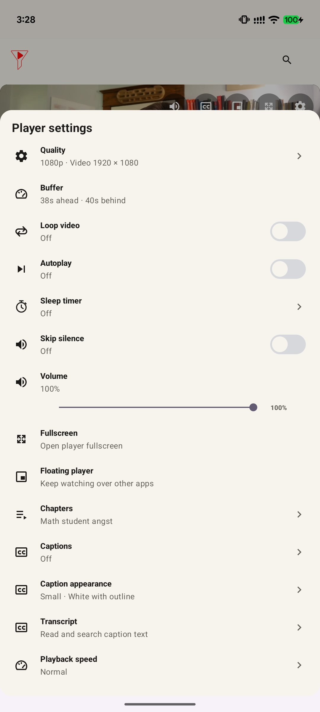
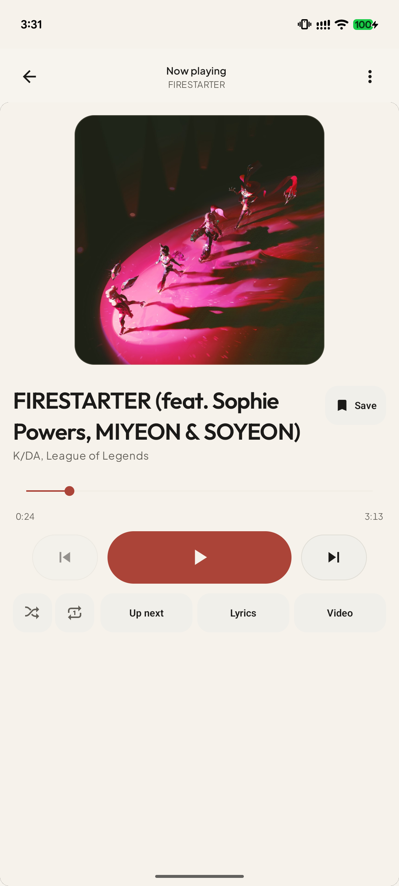
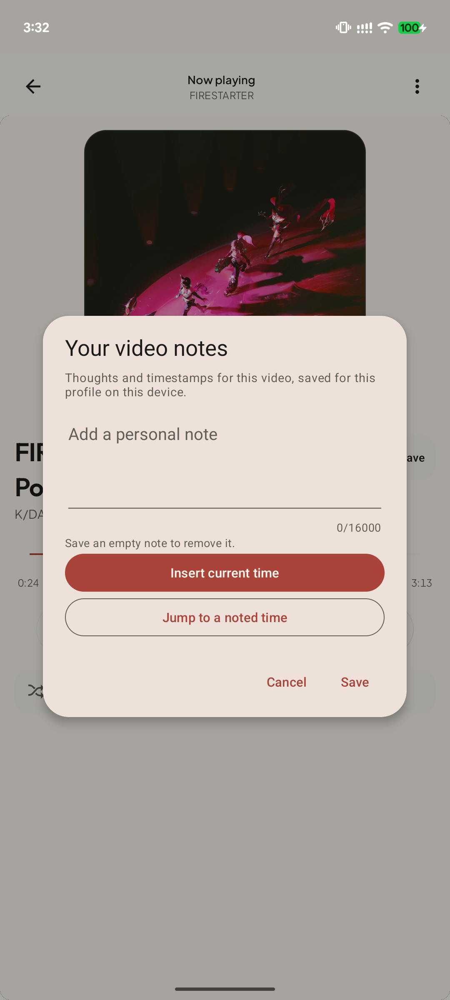
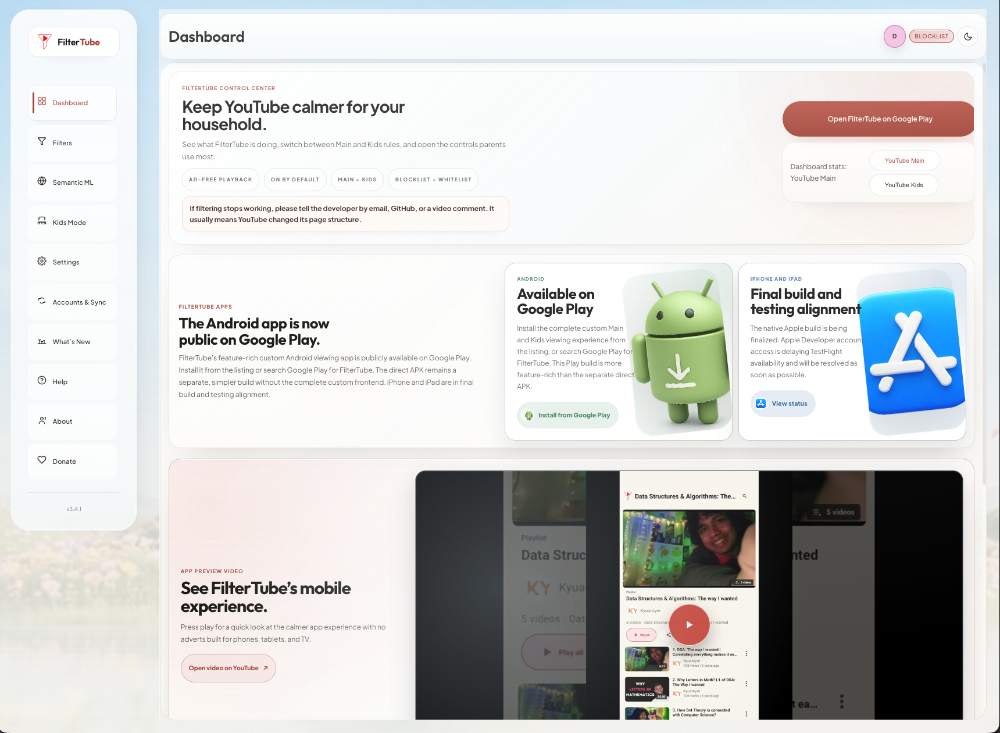
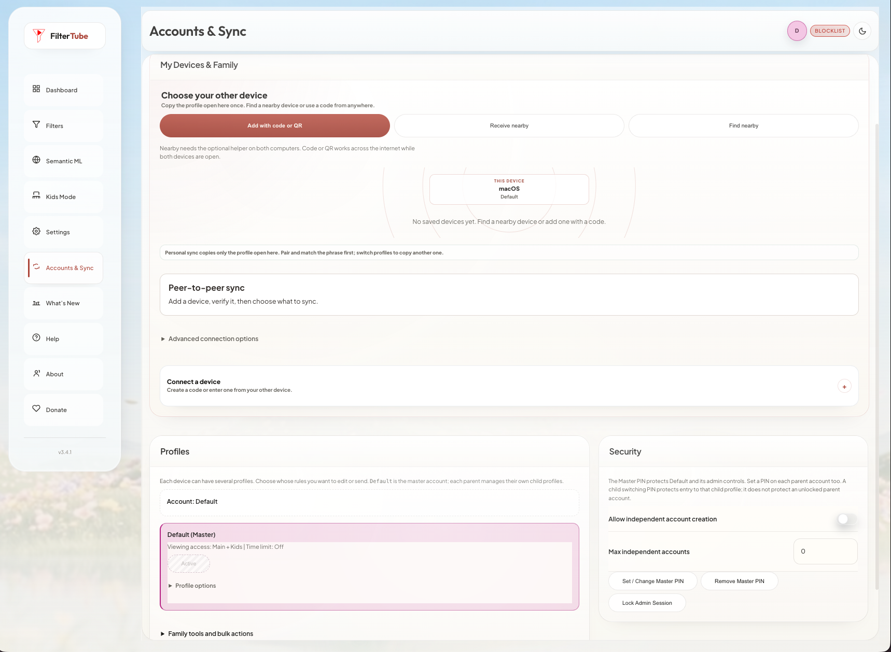
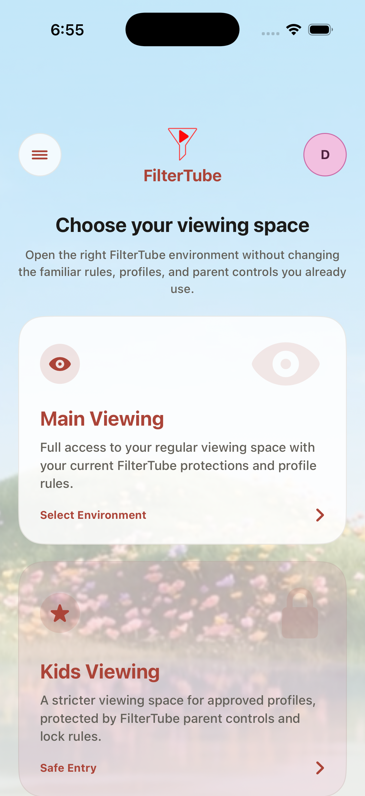
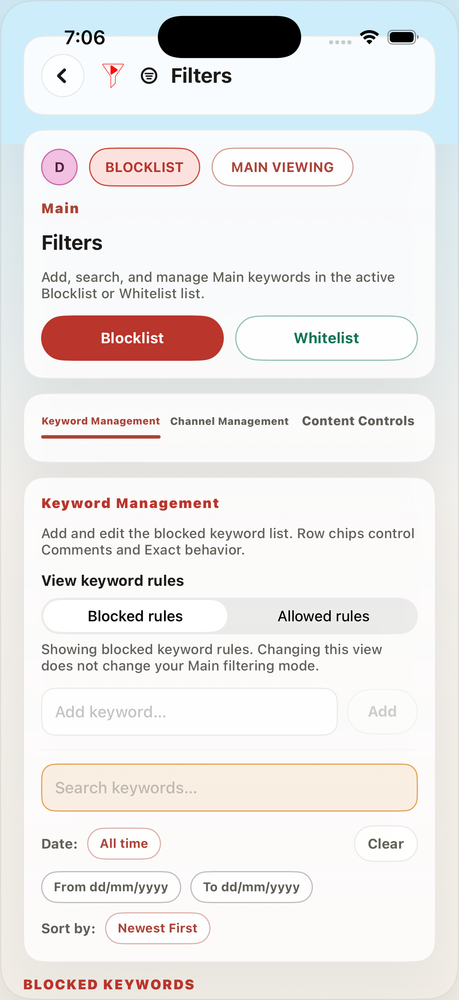

<div align="center">
  
  <h1>FilterTube</h1>
  <p>Calmer viewing. Your devices. Your rules.</p>

[](https://github.com/varshneydevansh/FilterTube/releases/latest)
[](LICENSE)

[Get Android app](https://play.google.com/store/apps/details?id=com.filtertube.app) · [Get browser extension](https://filtertube.in/downloads) · [Explore the website](https://filtertube.in)
</div>

FilterTube is a local-first viewing and filtering project for **Android and desktop browsers**. Block unwanted channels or words, allow only what you choose, quiet distracting surfaces, and give each family profile its own rules. Verified devices can share selected updates through **Nanah peer-to-peer (P2P) sync**.

**For families:** children can have their own PIN-protected profiles while parents manage protected settings from their own machine. [See the parent workflow](#easy-parent-controls).

## Get FilterTube

| Platform | Availability | Install or learn more |
| --- | --- | --- |
| **Android phone and tablet** | Public custom Main and Kids app on Google Play. No invitation or email needed. | [Google Play](https://play.google.com/store/apps/details?id=com.filtertube.app) · [Android overview](https://filtertube.in/android) |
| **Browser extension** | Chrome, Firefox and Edge listings; compatible desktop browsers use the appropriate store or manual package. | [Chrome](https://chromewebstore.google.com/detail/filtertube/cjmdggnnpmpchholgnkfokibidbbnfgc) · [Firefox](https://addons.mozilla.org/en-US/firefox/addon/filtertube/) · [Edge](https://microsoftedge.microsoft.com/addons/detail/filtertube/lgeflbmplcmljnhffmoghkoccflhlbem) |
| **iPhone and iPad** | In development; public TestFlight/App Store access is not available yet. | [iOS status](https://filtertube.in/ios) |
| **Android TV** | Separate development build; not included in the public phone/tablet listing. Fire TV support is planned. | [TV development](https://filtertube.in/android#android-tv) |

[Latest GitHub release and assets](https://github.com/varshneydevansh/FilterTube/releases/latest) · [All releases](https://github.com/varshneydevansh/FilterTube/releases)

The direct APK is a **separate, simpler build** from the complete custom app on Google Play. Repository features and development screenshots can be newer than public store releases; availability varies by platform and build.

## The Android app

The app has its own browsing and playback interface: **Home, Search, Watch, channels, Subscriptions, You, History, Playlists and Shorts**, alongside a separate **Kids** experience. It is a full app, not just a remote control for the extension.

Newer development work also includes **Music Home/Explore, artists, albums, library and Now Playing; video Notes; opt-in Auto-sync; and a local-file library/player**. Downloading online videos for offline use is separate ongoing work. Do not assume every development feature is in the current Play release.

<table>
  <tr>
    <th>Playback settings</th>
    <th>Music player</th>
    <th>Video Notes</th>
  </tr>
  <tr>
    <td></td>
    <td></td>
    <td></td>
  </tr>
</table>

*Real Android development-build captures. The empty Notes editor shows the interface, not a completed save or cross-device sync test. [More app details](https://filtertube.in/android).*

<details>
<summary><strong>Browser extension screenshots</strong></summary>

The extension adds a popup, dashboard and device controls to supported existing pages. These current-source previews can be newer than the installed store version.

<table>
  <tr><th>Dashboard</th><th>Accounts &amp; Sync</th></tr>
  <tr>
    <td></td>
    <td></td>
  </tr>
</table>

</details>

<details>
<summary><strong>iPhone development previews</strong></summary>

Existing simulator UI captures: viewing-space selection and filter controls. Public iPhone/iPad installation is not available yet; these images do not establish current playback, complete feature parity or release readiness.

<table>
  <tr><th>Viewing spaces</th><th>Filter controls</th></tr>
  <tr>
    <td></td>
    <td></td>
  </tr>
</table>

</details>

## Easy parent controls

A child can have their **own profile and switching PIN** without gaining permission to change parent-managed settings. Parents keep their own account and use **Edit Rules** to manage the intended child, rather than sharing the parent PIN.

From the parent's own computer, pair and verify the child's device, then review the exact source and receiving child profile. Choose **Send update** for an approved one-time policy change, or explicitly turn on **Auto-sync** for that verified parent connection. Only supported, approved scopes can apply; the child's PIN does not grant settings, trust or profile-administration rights.

Auto-sync is a choice, not a consequence of trusting a device. Direct delivery needs both endpoints open and connected; offline changes wait for a verified reconnect. Parent accounts need their own protection too. [Step-by-step parent setup and current scope limits](docs/NANAH_USER_GUIDE.md#parents-update-the-intended-child-profile).

## Features

This is a current capability guide, not a claim that every store package or platform has identical support. See the [extension inventory](docs/audit/EXTENSION_FEATURE_INVENTORY_2026-10-25.md) and [post-release change record](docs/audit/POST_885AA49_CHANGELOG_2026-10-25.md) for source and verification boundaries.

| What you control | Capabilities |
| --- | --- |
| **Channels and keywords** | Blocklist or Whitelist, blocked/allowed exceptions, channel IDs, `@handles` and supported URLs, phrases, supported comment-keyword matching and Exact matching. Rule matching reuses compiled indexes. |
| **Main and Kids** | Separate rule spaces and modes; optional compatible use of Kids rules on Main. A Kids rule space is distinct from a protected child profile. |
| **Video filters** | Supported duration, upload-date, uppercase-title, minimum-view and category filters. Experimental video-language filtering depends on available metadata, not speech recognition. |
| **Less distraction** | Hide Shorts, comments, Home feeds, recommendations, live chat, Mixes, playlist panels, end screens and other supported surfaces. The extension has 32 content switches across seven groups. |
| **Playback** | Advert filtering and guarded content-only playback work. The extension retains the native desktop player; the Android app has its own player and quality/audio/caption controls. Compatibility still needs maintenance. |
| **Quick actions** | Extension popup, dashboard statistics and settings, optional hover Quick Block and a separate three-dot menu action. Supported collaboration cards can expose multiple creators. |
| **Family profiles** | Default/Master, independent accounts and parent-owned protected profiles, with separate rules and viewing access. Parents edit child rules through **Edit Rules**; a child PIN does not unlock parent controls. |
| **Protected time** | Per-profile daily allowances, remaining-time feedback and parent-reviewed extra-time requests. Extension Self-Control and Hard Timer Whitelist are separate reviewed countdowns with no in-app cancellation once started. Daily budgets are per installation, not pooled across devices. |
| **Video Notes** | Profile + video storage, timestamps and conflict-aware edits. Extension Notes support admitted Main Watch pages; native development has its own implementation. Music/Kids/Shorts parity is not implied. |
| **Devices** | Code/QR pairing, safety-phrase verification, one-time profile copies, authorized full-account migration, approved parent updates and opt-in personal settings/rules/Notes Auto-sync. See the connection limits below. |
| **Imports and backups** | Preview CSV, TXT, JSON, BlockTube and supported HTTPS rule lists; review reports and refreshed lists, or import subscribed channels into the whitelist. Plain/encrypted manual and automatic local FilterTube backups and reviewed BlockTube-compatible export have different scopes. Private extension Notes are excluded from ordinary backups. |
| **Everyday preferences** | Light/dark appearance, 38 bundled extension interface languages, update preferences and a reviewed preference reset. Reset preserves rules, modes, restrictions, Notes, PINs, time limits and verified-device permissions. |

Local semantic/ML filtering remains **research**, not an active released filtering engine. Interface translations are separate from video-language filtering.

## Nanah Device Trust & Sync

**Connect → verify → choose what to share.** No central FilterTube account is required.

1. Open **Accounts & Sync** on both supported devices. Add with a code or QR.
2. Compare and confirm the **same safety phrase** before saving trust.
3. Review the local profile, receiving profile/device and selected update.
4. Send once, or explicitly enable the permitted Auto-sync link.

| Connection | What it permits |
| --- | --- |
| **Your own profiles** | A one-time copy, or a separately approved personal Auto-sync link. Both devices approve the exact profile mapping and choose **Settings and filter rules**, **Saved video notes**, or both. |
| **Parent → child** | Approved signed policy updates to the chosen protected profile. Parent Auto-sync uses existing approved scopes and receiver permissions; it does not grant the child permission to edit protected settings. |
| **Nearby devices** | Optional helper-assisted discovery. Being visible or on the same Wi-Fi never establishes trust. |

**Auto-sync is opt-in. Direct sync needs both Accounts & Sync pages open and connected.** Offline changes wait locally and resume after a verified connection is re-established. Simply going online does not pair saved devices or wake a closed browser. Settings conflicts require review; Notes preserve edit/delete conflicts. Turning Auto-sync off stops its local queued delivery, not data already applied elsewhere.

PINs, profile ownership and device permissions stay local. Parent policy updates do not currently cover every child preference toggle or child Notes; personal Auto-sync cannot bypass those restrictions.

Signaling and STUN services help devices establish a connection. No TURN relay is configured in the current extension transport, so restrictive networks can prevent a direct connection. Optional **Home Pickup** uses a configured trusted service that can see signed rule contents; **Internet Pickup** holds encrypted signed envelopes for approved parent updates. These are separate delivery choices, not a central readable profile vault. Queued, received and applied are different states.

New Auto-sync is implemented in the extension candidate; Android development has related adoption work. Installed two-profile pairing/offline reconnect, physical-network behavior and extension↔app interoperability still need acceptance. Older app/TV clients are not assumed compatible.

[Start with the Nanah user guide](docs/NANAH_USER_GUIDE.md) · [Auto-sync contract and scope](docs/design/device-sync/AUTO-SYNC-2026-10-24.md) · [Profiles and PINs](docs/PROFILES_PIN_MODEL.md) · [QA and remaining gates](docs/NANAH_MANAGED_LINK_QA.md)

## Start with one rule

1. Install the app or extension and choose the intended profile.
2. Add a channel using its `@handle`, channel ID or supported URL, or add a keyword.
3. Choose Blocklist to hide matches, or Whitelist to allow only your chosen rules. In the extension, refresh the page to check the result.
4. Add Kids rules, family profiles, viewing limits or device sharing when needed.

For a protected profile, use the owning parent's **Edit Rules** action and lock the parent/admin session afterward. Protect parent accounts too: a child switching PIN cannot secure an unprotected parent account.

<details>
<summary><strong>Privacy and filtering limits</strong></summary>

**Local-first runtime.** Extension rules and settings stay in browser storage. The extension does not run a FilterTube account service, extension analytics, or ad-tracking profile. YouTube and YouTube Kids pages still load their normal services, and weak identity targets may use bounded YouTube resolver requests. Device-sync services can observe connection metadata; Home/Internet Pickup have the distinct data boundaries described above.

**JSON-First Channel Identity.** JSON-backed surfaces can be filtered before paint when YouTube exposes the needed fields. Menu actions use proven local identity where available; weak targets may still use a resolver. Identity comes from intercepted data, learned maps and DOM evidence; bounded fallback resolvers remain for weak watch, Shorts, Kids, playlist, and menu targets. Some route-specific surfaces still need DOM enrichment or a bounded background resolver. Current audit work is tightening no-rule, route, lifecycle, and resolver budgets.

Shorts blocking is fastest when FilterTube already has a stable `videoId -> UC...` mapping. Some Shorts surfaces still expose only `/shorts/VIDEO_ID` at first; the video id is treated as a join key until a stronger owner source is available. FilterTube may use a bounded watch/Shorts resolver. That path is slower, route-specific, and still needs the same source-confidence and side-effect proof as the rest of the identity waterfall.

An unmanaged browser/device owner can disable or uninstall the extension. No permanent advert-filtering immunity, universal layout coverage, trusted clock or pooled cross-device time budget is promised. Private Notes and Auto-sync enrollment/queue state are not ordinary backup payloads.

[Privacy policy](https://filtertube.in/privacy) · [Channel identity details](docs/PROACTIVE_CHANNEL_IDENTITY.md) · [Architecture](docs/ARCHITECTURE.md)

</details>

## Development and documentation

This repository contains the **extension runtime and website**. Native apps have their own implementations and release checks; a successful extension test or build is not proof of native parity.


```bash
npm install
npm run build:chrome       # Package in dist/chrome
npm run build:firefox      # Package in dist/firefox
npm run build             # All supported browser packages
```

Load `dist/chrome` as an unpacked extension in Chrome/Edge/Brave, or load `dist/firefox/manifest.json` through Firefox's temporary-addon tooling. Development manifest selectors are `npm run dev:chrome` and `npm run dev:firefox`; they change the root `manifest.json`. Build scripts update the source-version badge; release publication remains a separate reviewed action.

For the website, run `npm install` then `npm run dev` from `website/`. For native apps and Android debugging, use the [app release/runtime workflow](docs/APP_RELEASE_AND_RUNTIME_SYNC_WORKFLOW.md) and [Android distribution guide](docs/ANDROID_PUBLIC_DISTRIBUTION.md).

- [Developer guide](docs/DEVELOPER_GUIDE.md) · [Architecture](docs/ARCHITECTURE.md) · [Technical reference](docs/TECHNICAL.md)
- [Imports and subscribed channels](docs/SUBSCRIBED_CHANNELS_IMPORT.md) · [Kids integration](docs/YOUTUBE_KIDS_INTEGRATION.md)
- [Changelog](CHANGELOG.md) · [Current change audit](docs/audit/POST_885AA49_CHANGELOG_2026-10-25.md) · [Sync concerns](docs/NANAH_POST_IMPLEMENTATION_CONCERNS_TRACKER.md)

## Community and support

[Report an issue](https://github.com/varshneydevansh/FilterTube/issues) · [Reddit: r/FilterTubeApp](https://www.reddit.com/r/FilterTubeApp/) · [Support development](https://ko-fi.com/filtertube)

FilterTube grew from a [parent's request for clearer Kids filtering](https://support.google.com/youtubekids/thread/54509605/how-to-block-videos-by-keyword-or-tag?hl=en). It is for families, students and anyone who wants more control over what they watch.

Released under the [MIT License](LICENSE). Detailed release history lives in [CHANGELOG.md](CHANGELOG.md).
