<div align="center">
  
  <h1>FilterTube</h1>
  <p>Calmer viewing. Your devices. Your rules.</p>

[](https://github.com/varshneydevansh/FilterTube/releases/latest) [](LICENSE) [](https://deepwiki.com/varshneydevansh/FilterTube)    

[Get it on iPhone and iPad](https://filtertube.in/ios) · [Get the Android app](https://play.google.com/store/apps/details?id=com.filtertube.app) · [Get the browser extension](https://filtertube.in/downloads) · [Explore the website](https://filtertube.in)
</div>

FilterTube puts **you** in charge of what you watch. Block channels or words, or allow only what you choose. Give every family member their own profile, plan focused study time, and keep your devices in sync **privately, device to device**, with no FilterTube account.

This repository is the **FilterTube browser extension**, released under the [MIT License](LICENSE). The same rules also run in the **FilterTube apps** for Android phones and tablets, Android TV, and iPhone and iPad.

## Meet Kriti and Uljhan

<table>
  <tr>
    <td width="150" align="center"></td>
    <td><strong>Kriti</strong> is the creator's sister. She stands for the care and protection she gave him growing up, and FilterTube passes that care on, so you can look after yourself and the people you love.</td>
  </tr>
  <tr>
    <td width="150" align="center"></td>
    <td><strong>Uljhan</strong> means a tangle. He's the clutter we'd rather not see: not something to hate, just not what you want in your feed. Kriti clears it gently, and Uljhan hops off happily.</td>
  </tr>
</table>

They keep you company in the apps and the extension: while pages load, when a list is empty, when you're offline, during Study breaks and when something is kept out. Choose Lively, Quiet or Off in Settings › Companion; nothing moves when your system asks for reduced motion.

## What FilterTube does

- **Your rules everywhere.** Block or allow channels and keywords (Korean, Japanese and Chinese keywords match inside sentences). Filter by category, language, duration, upload date and minimum views. Hide Clips, comments, Home feeds and other distractions, and block a channel straight from any video card.
- **What Uljhan tried today.** Home lists what FilterTube kept out today, on this device only. Allow one video as an exception, or jump straight to the content control that hid it.
- **Study.** Ready-made packs for exams, school classes and skills in 56 countries, a day plan with rounds and real breaks, and a Day Ring that fills as you study. During a round, only your plan's channels and topics show, and Search looks in your plan's channels first.
- **Kids.** A separate Kids space with its own rules, Kids learning packs by age during Study, and a parent PIN for every change.
- **Family.** Profiles with PINs and crayon avatars, parent-managed time limits, Self-Control sessions that lock your rules for a set time, and **Ask a parent**: a child can ask to watch a blocked video or allow a channel, and a parent answers with Allow once or Always allow.
- **Private P2P sync (Nanah).** Pair two devices with a code or QR, compare the safety phrase, then choose what to share: rules, settings, Study plans and video Notes. Updates travel directly and encrypted between your devices. No FilterTube account and no cloud copy of your rules.
- **FilterTube's own words.** Clips, Following, Saved, Popular, Auto playlists, and **Sangeet** for music, in all 38 interface languages.

In the apps there is also a complete viewer: Home, Search, Watch, channels, Following, You, history, playlists and Saved, with chapters, a floating mini player, picture-in-picture, background play, a sleep timer, captions and quality controls. **Sangeet** has its own Home, Explore, moods, podcasts and a player with lyrics and a reorderable queue. Optional SponsorBlock, dislike counts and DeArrow titles stay off until you turn them on.

**Free, with no paywall.** Every feature is available to everyone. If FilterTube helps you, you can support it in whatever way feels right, monthly, once or any amount. Supporting never unlocks features. [Ways to support](#community-and-support).

## Get FilterTube

### Get the iOS app

FilterTube runs on iPhone and iPad. Apple is having trouble on their end with the developer account, so the App Store version will take a while. Until then:

1. On your iPhone or iPad, open **[filtertube.in/ios](https://filtertube.in/ios)**. It has the full guide and the buttons.
2. Set up **SideStore** once (recommended), following that guide. **AltStore** works too.
3. Tap **Add to SideStore**, or add the source `https://filtertube.in/ios/source.json` yourself, then install FilterTube.
4. On a free Apple ID, refresh FilterTube in SideStore within 7 days. Your settings are kept.

Free, no ads, nothing locked, no FilterTube sign-up.

| Platform | Availability | Install or learn more |
| --- | --- | --- |
| **iPhone and iPad** | New in 3.6.2. Install with SideStore (recommended) or AltStore while the App Store version waits on trouble on Apple's side. The IPA is attached to every GitHub release. | [iPhone and iPad guide](https://filtertube.in/ios) |
| **Android phone and tablet** | The full Main and Kids app on Google Play. No invitation or email needed. | [Google Play](https://play.google.com/store/apps/details?id=com.filtertube.app) · [Android overview](https://filtertube.in/android) |
| **Android TV / Google TV** | On the same Google Play listing as the phone app. A TV APK is attached to every GitHub release. | [Android TV](https://filtertube.in/android-tv) · [Latest release](https://github.com/varshneydevansh/FilterTube/releases/latest) |
| **Direct Android build** | GitHub-only phone/tablet and TV APKs with offline video saving (encrypted copies that expire after 30 days) and in-app update checks. Installs beside the Play app. The Google Play builds do not download videos. | [Latest release](https://github.com/varshneydevansh/FilterTube/releases/latest) |
| **Browser extension** | Chrome, Firefox and Edge listings; other desktop browsers use the matching store or the manual package. | [Chrome](https://chromewebstore.google.com/detail/filtertube/cjmdggnnpmpchholgnkfokibidbbnfgc) · [Firefox](https://addons.mozilla.org/en-US/firefox/addon/filtertube/) · [Edge](https://microsoftedge.microsoft.com/addons/detail/filtertube/lgeflbmplcmljnhffmoghkoccflhlbem) |

[Latest GitHub release and assets](https://github.com/varshneydevansh/FilterTube/releases/latest) · [All releases](https://github.com/varshneydevansh/FilterTube/releases)

## Screenshots

<table>
  <tr><th>iPhone: Home</th><th>iPhone: Study</th><th>Android: Study session</th><th>Android: Sangeet</th></tr>
  <tr>
    <td>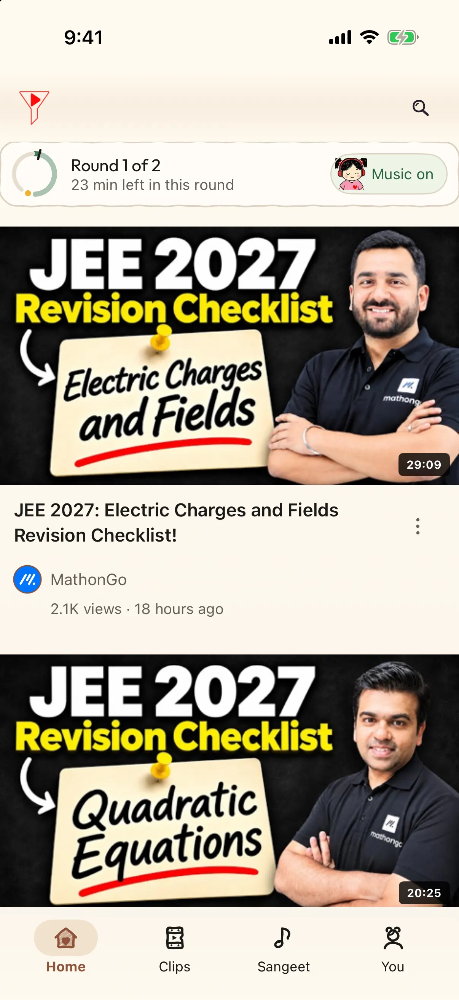</td>
    <td>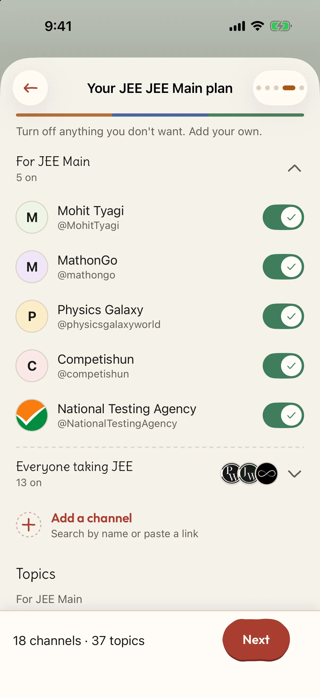</td>
    <td>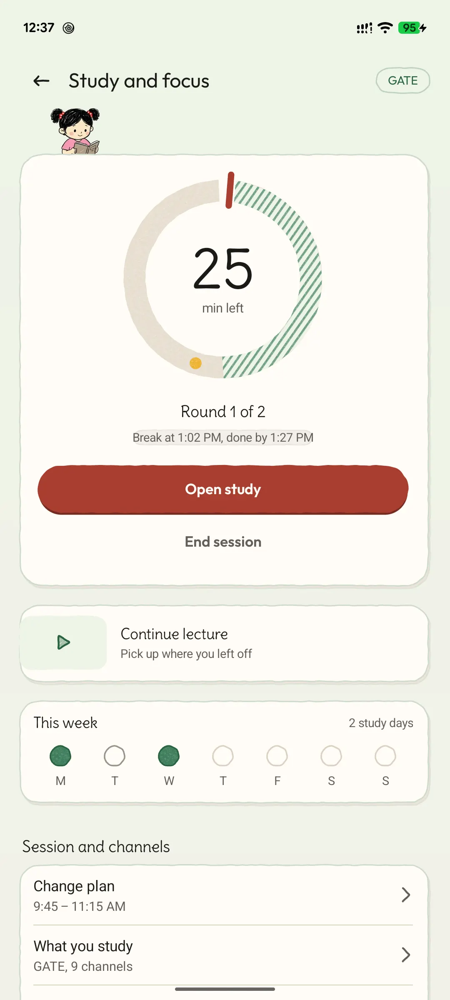</td>
    <td>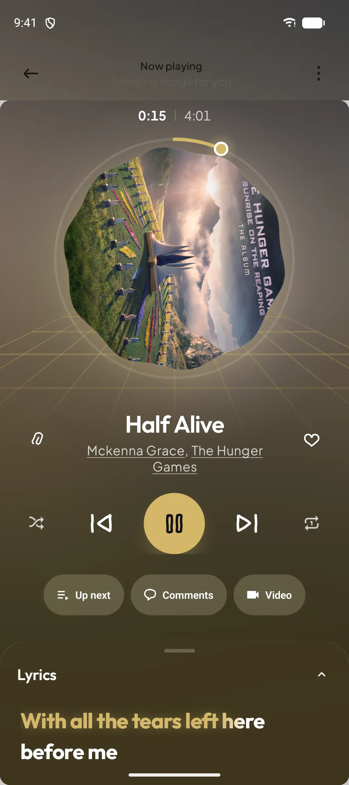</td>
  </tr>
</table>

<table>
  <tr><th>Android: Home during Study</th><th>Android: Controls</th><th>Android: private P2P pairing</th><th>Kids on iPhone</th></tr>
  <tr>
    <td>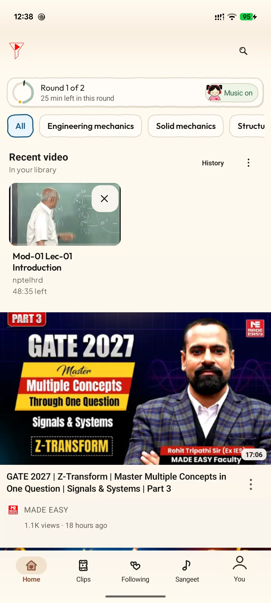</td>
    <td>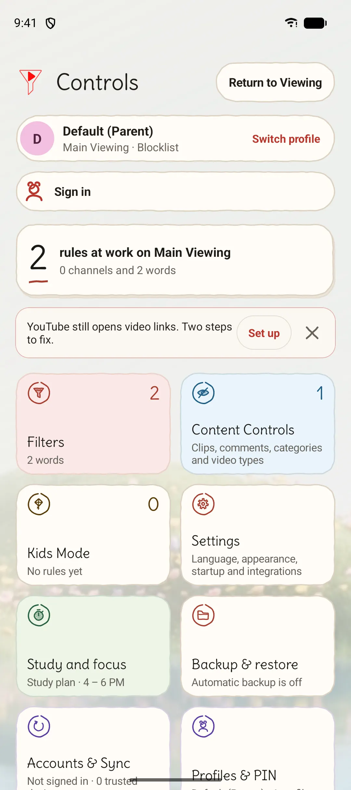</td>
    <td>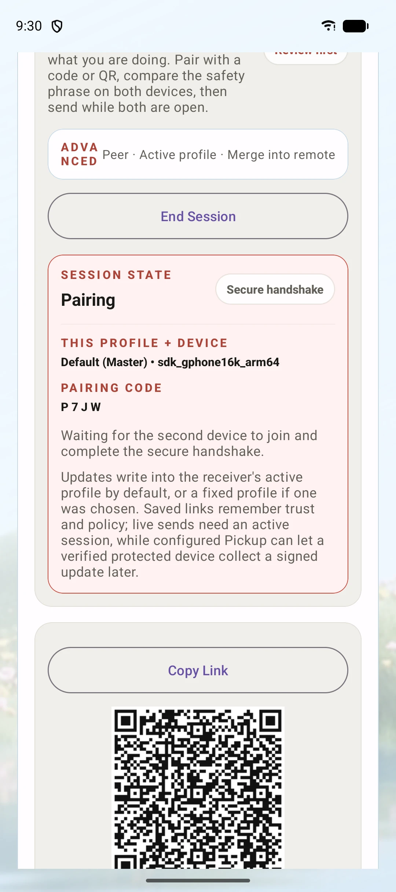</td>
    <td>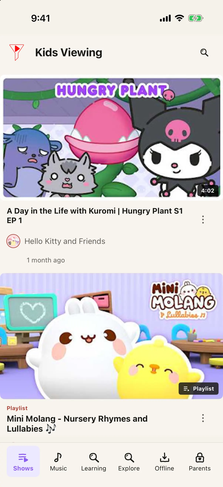</td>
  </tr>
</table>

<table>
  <tr><th>iPad: Watch</th><th>Android TV: Home</th></tr>
  <tr>
    <td>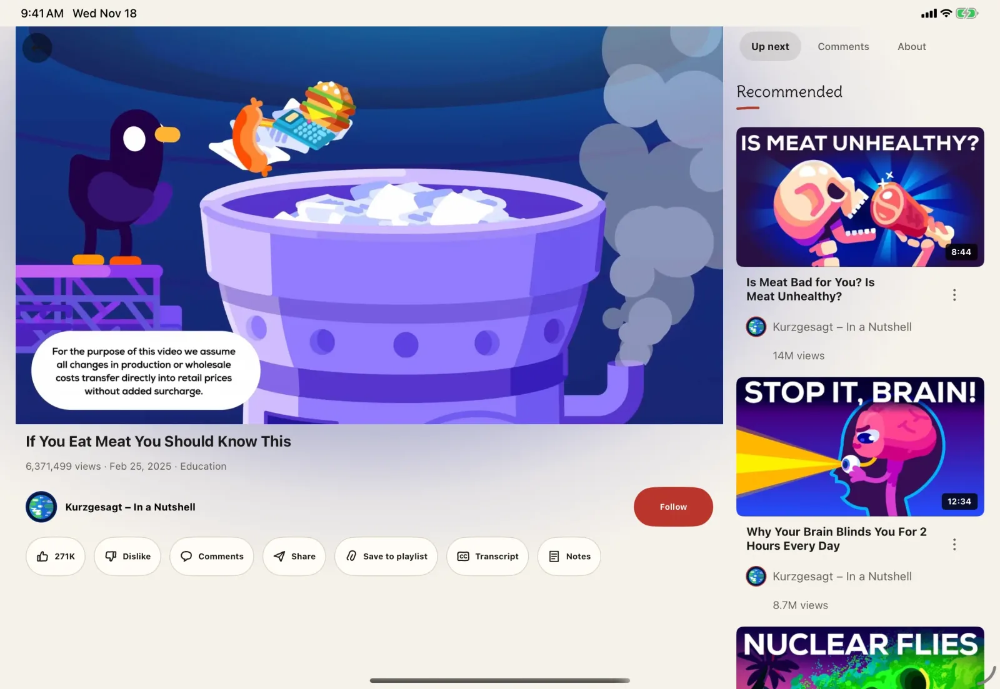</td>
    <td>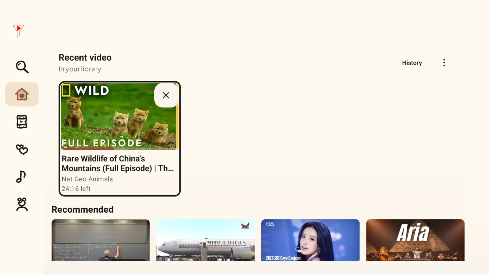</td>
  </tr>
  <tr><th>iPad: Kids</th><th>Android TV: Kids</th></tr>
  <tr>
    <td>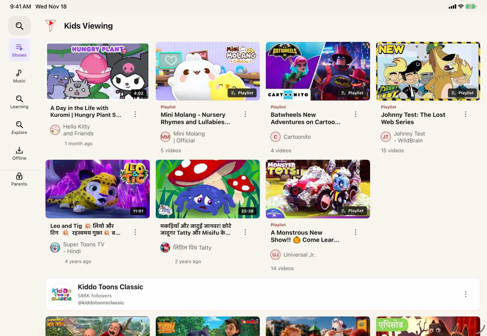</td>
    <td></td>
  </tr>
</table>

*Real screens from the latest builds. See every phone, tablet, iPad and TV screen on [filtertube.in](https://filtertube.in).*

### Browser extension

<table>
  <tr><th>Controls: Home</th><th>Popup</th></tr>
  <tr>
    <td>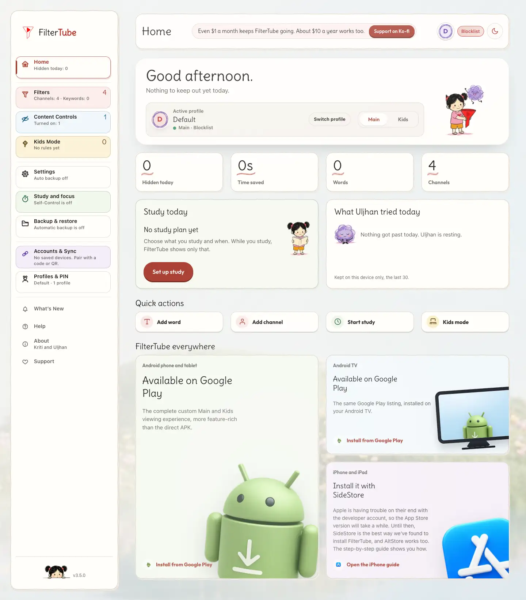</td>
    <td valign="top">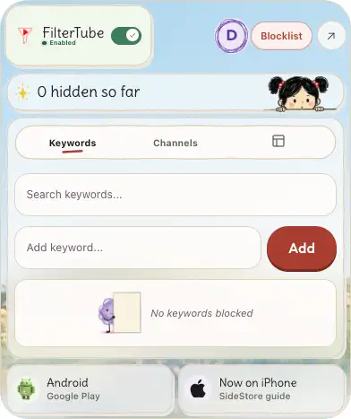</td>
  </tr>
</table>

## Easy parent controls

A child can have their **own profile and switching PIN** without gaining permission to change parent-managed settings. Parents keep their own profile and manage the child's rules in a framed parent session, rather than sharing the parent PIN. **Quiet blocking** (off by default, parent-locked) shows a plain "This video isn't available" screen instead of FilterTube's block screen, so children aren't upset by it.

From the parent's own device, pair and verify the child's device, then review the exact source and receiving child profile. Send a one-time update, or turn on **Auto-sync** for that verified parent connection. Study plans and locks a parent sets travel the same way, and the parent sees when a child's device stops reporting. The child's PIN never grants settings, trust or profile-administration rights.

Auto-sync is a choice, not a consequence of trusting a device. [Step-by-step parent setup and current scope limits](docs/NANAH_USER_GUIDE.md#parents-update-the-intended-child-profile).

## Features in the extension

This is a current capability guide, not a claim that every store package or platform has identical support. See the [changelog](CHANGELOG.md) and the [3.6.2 release record](docs/RELEASE_3_6_2_2026-11-18.md).

| What you control | Capabilities |
| --- | --- |
| **Channels and keywords** | Blocklist or Whitelist (allow only selected), with blocked exceptions under a Whitelist. Channel IDs, `@handles` and supported URLs, phrases, comment-keyword matching and Exact matching. Undo after a removal. |
| **Main and Kids** | Separate rule spaces and modes; Kids words, allowed videos and followed channels work as in the apps. |
| **Video filters** | Duration, upload date, uppercase titles, minimum views and category. Experimental video-language filtering depends on available metadata, not speech recognition. |
| **Less distraction** | Hide Clips, comments, Home feeds, recommendations, live chat, Auto playlists, playlist panels, end screens and more, from the Content Controls switches. Search suggestions follow your rules in every mode. |
| **Home and the hidden log** | A Home with today's numbers, Study today, What Uljhan tried today (the last 30 hides, on this device only) and quick actions. |
| **Study** | Packs, a day plan with rounds and breaks, a length slider, Skip break with Undo, "Skip this video", rules that hold while a session runs, and a clock guard so moving the clock doesn't end a lock. |
| **Family profiles** | Parent, adult and Kids profiles with PINs, crayon avatars, Ask a parent with signed answers, a framed parent session, and Quiet blocking. |
| **Protected time** | Per-profile daily allowances and Self-Control sessions that can't be cancelled once started. Daily budgets are per installation, not pooled across devices. |
| **Video Notes** | Private, timestamped Notes per profile and video. |
| **Devices** | Code/QR pairing, safety-phrase verification, one-time profile copies, full-account moves, approved parent updates and opt-in personal Auto-sync. FilterTube asks once before the first internet sync uses the relay. |
| **Imports and backups** | CSV, TXT, JSON, BlockTube and HTTPS rule lists; import followed channels into the Whitelist; plain and encrypted backups; BlockTube-compatible export. |
| **Everyday preferences** | Light and dark, 38 interface languages, Kriti and Uljhan (Lively, Quiet or Off), optional sounds (Off by default) and a reviewed preference reset. |

Local semantic/ML filtering remains **research**, not an active filtering engine. Interface translations are separate from video-language filtering.

## Nanah Device Trust & Sync

**Connect → verify → choose what to share.** No central FilterTube account is required.

1. Open **Accounts & Sync** on both devices. Add with a code or QR.
2. Compare and confirm the **same safety phrase** before saving trust.
3. Review the local profile, receiving profile or device and the selected update.
4. Send once, or explicitly turn on Auto-sync for that link.

| Connection | What it permits |
| --- | --- |
| **Your own profiles** | A one-time copy, or a separately approved personal Auto-sync link. Both devices approve the exact profile mapping and choose what is shared. |
| **Parent → child** | Approved, signed policy updates to the chosen protected profile, including Study plans and locks. A Kids profile accepts Nearby rules only after the parent's PIN. |
| **Nearby devices** | Optional discovery. Being visible or on the same Wi-Fi never establishes trust. |

**Auto-sync is opt-in. Direct sync needs both Accounts & Sync pages open and connected.** Offline changes wait locally and resume after a verified reconnect. Signaling and STUN services help devices connect; FilterTube explains what the relay can see before the first internet sync. Optional **Home Pickup** and **Internet Pickup** are separate delivery choices for parent updates, not a central readable profile vault.

[Nanah user guide](docs/NANAH_USER_GUIDE.md) · [Auto-sync contract and scope](docs/design/device-sync/AUTO-SYNC-2026-10-24.md) · [Profiles and PINs](docs/PROFILES_PIN_MODEL.md) · [QA and remaining gates](docs/NANAH_MANAGED_LINK_QA.md)

## Start with one rule

1. Install the app or extension and choose the profile.
2. Add a channel by its `@handle`, channel ID or URL, or add a keyword.
3. Choose Blocklist to hide matches, or Whitelist to allow only your chosen rules.
4. Add Kids rules, family profiles, a Study plan, time limits or device sharing when you need them.

<details>
<summary><strong>Privacy and filtering limits</strong></summary>

**Local-first runtime.** Extension rules and settings stay in browser storage, and so does the hidden log. The extension does not run a FilterTube account service, extension analytics, or ad-tracking profile, and its fonts ship inside it. YouTube and YouTube Kids pages still load their normal services, and weak identity targets may use bounded YouTube resolver requests. Device-sync services can see connection metadata; Home and Internet Pickup have their own data boundaries described above. Removing the extension opens filtertube.in/uninstalled.

**JSON-First Channel Identity.** JSON-backed surfaces can be filtered before paint when YouTube exposes the needed fields. Menu actions use proven local identity where available; weak targets may still use a resolver. Identity comes from intercepted data, learned maps and DOM evidence; bounded fallback resolvers remain for weak watch, Shorts, Kids, playlist, and menu targets. Some route-specific surfaces still need DOM enrichment or a bounded background resolver. Current audit work is tightening no-rule, route, lifecycle, and resolver budgets.

Shorts blocking is fastest when FilterTube already has a stable `videoId -> UC...` mapping. Some Shorts surfaces still expose only `/shorts/VIDEO_ID` at first; the video id is treated as a join key until a stronger owner source is available. FilterTube may use a bounded watch/Shorts resolver. That path is slower, route-specific, and still needs the same source-confidence and side-effect proof as the rest of the identity waterfall.

An unmanaged browser or device owner can disable or uninstall the extension, and private windows are covered only where the browser allows it (the Study page names the policies families can use). No universal layout coverage or pooled cross-device time budget is promised.

[Privacy policy](https://filtertube.in/privacy) · [Channel identity details](docs/PROACTIVE_CHANNEL_IDENTITY.md) · [Architecture](docs/ARCHITECTURE.md)

</details>

## Development and documentation

This repository contains the **extension runtime and the website**. The apps have their own implementations and release checks; a passing extension test or build is not proof that the apps match.


```bash
npm install
npm run build:chrome       # Package in dist/chrome
npm run build:firefox      # Package in dist/firefox
npm run build              # All supported browser packages
npm test                   # Smoke test lane
```

Load `dist/chrome` as an unpacked extension in Chrome, Edge or Brave, or load `dist/firefox/manifest.json` through Firefox's temporary add-on tooling. `npm run dev:chrome` and `npm run dev:firefox` switch the root `manifest.json`. Every build refreshes the version and line-count badges in this README; publishing a release stays a separate, reviewed step.

For the website, run `npm install` then `npm run dev` from `website/`. For app releases, see the [app release and runtime sync workflow](docs/APP_RELEASE_AND_RUNTIME_SYNC_WORKFLOW.md) and the [Android distribution guide](docs/ANDROID_PUBLIC_DISTRIBUTION.md).

- [Developer guide](docs/DEVELOPER_GUIDE.md) · [Architecture](docs/ARCHITECTURE.md) · [Technical reference](docs/TECHNICAL.md)
- [Imports and followed channels](docs/SUBSCRIBED_CHANNELS_IMPORT.md) · [Kids integration](docs/YOUTUBE_KIDS_INTEGRATION.md)
- [Changelog](CHANGELOG.md) · [Android → extension port ledger](docs/parity/PORT_LEDGER.md) · [Sync concerns](docs/NANAH_POST_IMPLEMENTATION_CONCERNS_TRACKER.md)

## Community and support

[Report an issue](https://github.com/varshneydevansh/FilterTube/issues) · [Reddit: r/FilterTubeApp](https://www.reddit.com/r/FilterTubeApp/) · [Support development](https://ko-fi.com/filtertube)

FilterTube grew from a [help-forum question about blocking videos by keyword](https://support.google.com/youtubekids/thread/54509605/how-to-block-videos-by-keyword-or-tag?hl=en) that 2,500 parents asked before the thread was locked. It is for families, students and anyone who wants more control over what they watch.

The browser extension in this repository is released under the [MIT License](LICENSE). Detailed release history lives in [CHANGELOG.md](CHANGELOG.md).
