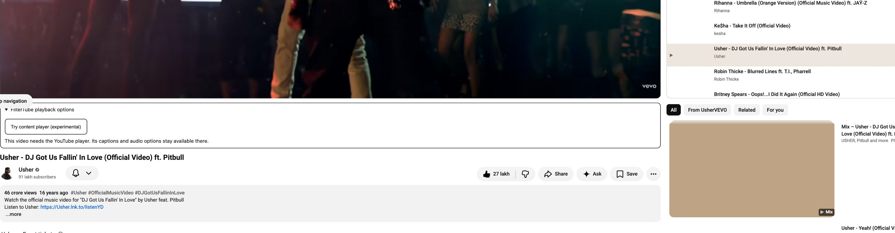

# Content-only playback implementation — 2026-10-22

Current status: the separate-player pilot failed installed acceptance (Shakira media error and fullscreen containment). It has been removed from the active manifest chain. A native YouTube source transaction is implemented and undergoing end-to-end validation. Developer probes decoded resolved content in the original YouTube video element; native fullscreen, installed profile acceptance and Firefox remain gates.

The sections through the owned-resolver/MSE follow-on retain historical implementations. The superseding native-player section below records the current direction and its evidence boundaries. This is not Android playback parity or a guarantee against future YouTube changes. No publish, push, native-runtime synchronization or external issue posting is authorized.

The subsequent automatic preference and playlist correction are documented in [Automatic native playback — 2026-10-23](CONTENT_ONLY_PLAYBACK_AUTOMATION_2026-10-23.md). The per-video UX described below is historical.

## User experience and default behavior

On desktop `www.youtube.com/watch`, enabled FilterTube with sponsored filtering offers a closed **FilterTube playback options** disclosure. **Try content player (experimental)** requests a source only after the user chooses it and existing profile admission permits the video. The user can cancel while checking/preparing, or return to YouTube's player afterward. No automatic player replacement, new host permission, remote library or account mutation is introduced. Mobile, Kids, embeds, live/protected streams and unsupported source/feature combinations retain their existing playback path.

The pilot accepts an exact-current-video, playable, browser-compatible combined audio/video HTTPS Googlevideo source already provided by the page. It rejects unresolved cipher/throttling transforms, SABR-only, adaptive-only and manifest-only sources. It also requires explicit caption/audio evidence and a proven current content timeline; it never copies an advert's playback position into main content. Therefore the pilot does not yet eliminate the reported initial streaming backoff.

## Owned components

- `js/shared/content_playback_source.js`: bounded pure source planning; no network, player-code execution or admission grants. Unsupported plans expose reasons/counts without signed URLs.
- `js/content/content_playback_response.js`: MAIN-world, current-route-only projection of loaded Player data and existing audio/caption selections. It copies no advert plans or tracking envelopes, makes no requests and cannot authorize playback.
- `js/content/content_playback_admission.js`: opaque, renewable one-second leases in the isolated context, bound to the actual settings reference, route epoch, exact video, active profile and the existing direct/category/managed authorities.
- `js/content/content_playback_captions.js`: abortable same-origin YouTube WebVTT preparation; exact video ID, bounded eight-second request budget, at most 32 tracks and 2 MiB aggregate. It retains signed query bytes except the requested VTT format. Failed or stale preparation does not partially authorize a handoff.
- `js/content/content_playback_player.js`: muted candidate staging, native controls, exact selected caption ID/language, Blob cleanup, explicit audio choice checks, finite source expiry and repeated lease validation. The original keeps playing during preparation. Only a genuinely playing/positioned candidate can replace it. Returning or failing before takeover leaves native media untouched; authority loss never seeks or resumes a newly selected route/profile.
- `js/content/content_playback.js`: isolated coordinator, user action, request generation/cancellation, native timeline/ownership rechecks and the accessible experimental disclosure. User interaction with the native controls during preparation cancels the candidate, preserving the latest intent.

All four manifests load the isolated helpers in dependency order on non-embed YouTube pages; the MAIN data bridge is bundled and included in the existing injection path. Other surfaces retain their prior script chain. No native app build or synchronization was run.

## Parent/child policy boundaries

The pilot does not create or edit profiles, rules, PINs, trusted devices or parent commands. A page message supplies media metadata only. It cannot supply a lease, an allow decision, profile identity or time authority.

Pending/blocked direct admission, unresolved enabled category/language policies, stale settings/profile/route identity, managed route denial and native-owned playback refuse handoff. Configured managed time limits currently retain the existing player until a fresh, authoritative time allowance is explicitly integrated. A child with no configured time policy still requires a known inactive time state and the same explicit content admission as an account profile.

Synchronous invalidation hooks cover route transitions, direct/category pauses, settings delivery, managed denial/timeouts and relevant storage changes before a delayed refresh. Pure metadata enrichment remains exempt. During that review a pre-existing fast path was corrected: an enrichment revision marker alone could incorrectly classify simultaneous profile/rule changes as metadata-only. The bridge now verifies equality after stripping only established enrichment fields. Other independent metadata classifiers were not broadened in this change.

## Acceptance checklist

- [x] Pure source planner rejects malformed, mismatched, cipher/throttling, DRM/live, incompatible and expired sources.
- [x] Caption preparation checks actual VTT and cancels on abort, expiry, oversize or stale authority.
- [x] Controller checks actual playing/seek/caption readiness and preserves pause, volume, rate and position; pre-handoff failure leaves native playback alone.
- [x] Admission tests cover parent/child, pending/blocked, route/profile/settings changes, time-policy refusal and opaque token ownership.
- [x] Coordinator tests exercise real planner/lease modules and a mocked media-controller boundary, separately from the real controller DOM fixtures.
- [ ] Installed Chrome: supported real YouTube content source plays independently, seeks, pauses and returns without duplicate audio.
- [ ] Installed Chrome: exact selected captions and audio survive; unsupported combinations leave existing controls working.
- [ ] Installed parent/child profiles: deny/pending, profile switch, policy/rule updates and time limits cannot be bypassed during staging or active playback.
- [ ] Installed Firefox: repeat source, media, caption, audio and policy acceptance.
- [ ] Broad browser-compatible cipher, throttling, adaptive and SABR resolution. No arbitrary observed media URL, fake advert completion or unreviewed remote code is substituted for this work.

The existing Android source resolver and Media3 architecture informed the ownership boundary, not a claim that its Java extractor can be copied directly into an extension. The implementation remains a limited pilot while the unchecked gates remain open. The previous [streaming backoff evidence](ADVERT_STREAMING_BACKOFF_AND_CONTENT_PLAYER_2026-10-22.md) still applies: the four-second server policy has not been removed or explained by this pilot.

## Review and validation record

Independent subagents implemented/reviewed source planning, caption preparation, player lifecycle and parent/child admission. Review found and corrected exact-caption selection, stale native timeline restoration, native-control intent during preparation and metadata-marker profile changes. FreeLLMAPI `gemini-3.8-flash` returned upstream HTTP 502 for a bounded critique; no model response was accepted as validation.

Final checks:

- All six new playback suites: **203/203 passed**.
- Existing direct admission, settings-order, selected-playlist, managed viewing/time and external playback suites: **100/100 passed**.
- Smoke: **612/612 passed**; release: **259/259 passed**, after updating intentional current source/manifest fingerprints and inventories. The first runs had three smoke and seven release inventory mismatches; semantic assertions and historical evidence were retained.
- All changed runtime files and README match source, staged output and ZIP bytes for Chrome, Firefox and Opera v3.4.1. Runtime syntax and whitespace checks passed.
- The broader JSON/performance lanes were not rerun for this pilot; their previously documented failures remain open. Passing the listed lanes does not establish overall release readiness.

### Installed observations after the user reload

The user reported relatively quick playback and supplied a screenshot showing the experimental fallback on `-wK200l4KNc`. Live inspection confirmed **zero owned players**, the original player playing at readyState 4 and `ad-not-active`. The pilot's exact rejection was `throttling_transform_required`: a supplied direct itag-18 URL contained `n`. A bounded `Range: bytes=0-2047` request to that exact supplied source returned **403** with no media sample. This supports refusing that source in the tested context, not a claim that `n` is the sole cause. Token/session/protocol restrictions may also apply. One read-only WEB/Safari-context experiment returned UNPLAYABLE and no streams; no alternate-client strategy was shipped.

The user's subsequent Shakira (`8OO1pOqRJkA`) and Usher (`C-dvTjK_07c`) navigations produced exact get_watch advert-plan and sponsored-renderer removal records. Usher was playing with no advert interruption detected and no owned player. A deliberate pilot attempt on Usher retained the native player (`captions_unsupported`); its source metadata also contained an unresolved signature cipher and SABR. Caption/source preparation did not authorize a partial handoff. These observations establish the existing advert sanitization and safe refusal on those samples, **not successful independent main-media playback** or future detection immunity.

[Redacted installed evidence](artifacts/content-only-playback-2026-10-22/installed-summary.json) omits signed URLs, transforms, opaque tokens, cookies and headers. The test screenshot below shows the fallback while normal Usher playback continues. A temporary agent-created video tab was closed; user tabs and profile settings were preserved. Browser tooling blocked raw CDP for that temporary tab, so it supplied no additional player acceptance evidence.

The unresolved resolver is a substantive gate. Permanent advert-filtering reliability cannot be guaranteed by this work, and the unchecked owned-player/caption/audio/parent-child/Firefox acceptance items remain open.

## Follow-on owned resolver and indexed-media transport — source implementation

The preceding sections preserve the earlier progressive-only pilot and its observations. This follow-on work implements the user's selected architecture: FilterTube owns a stable media-resolution interface, while bounded local adapters supply media data. The source changes below expand coverage; they do not turn the earlier fallback observations into successful owned-player acceptance.

`js/shared/content_playback_resolver.js` introduces the replaceable adapter boundary. Its current bundled adapters inspect the exact loaded progressive response and, when necessary, request fresh JSON for the same video using one fixed VisionOS client context following the currently documented NewPipe strategy. A bounded visitor-context request precedes the exact-video player request; both share the same eight-second deadline and aggregate 512 KiB response budget. Opaque visitor data and the content nonce stay in memory and are omitted from returned metadata. Both requests omit credentials and does not set content or age checks to true. The registry accepts packaged functions rather than remotely supplied executable instructions. No NewPipe Java library, remote-code evaluator, media proxy or fake advert-completion mechanism was added. Returned media descriptors remain separate from profile authorization. Route, video and lease freshness are checked throughout an abortable eight-second resolution budget, and responses are bounded before parsing.

The resolver normalizes exact-video, playable, finite VOD metadata into progressive or indexed adaptive MP4 descriptors. The adaptive plan pairs compatible AVC video with selected AAC audio, preserving audio-track identity and alternative choices where the available metadata proves them. Each descriptor carries its own initialization range, SIDX index range, source length and expiry. Unresolved cipher/throttling parameters, unsupported transports, uncertain audio selection, live/DRM media and unavailable features still cause fallback. A fresh transport response cannot grant permission to watch or replace the active account/profile.

`js/content/content_playback_transport.js` provides the browser MediaSource transport for these indexed audio/video descriptors. It validates SIDX byte references and content duration, uses the documented unsigned range query without reserializing signed URL bytes, requires exact bounded bodies for actual HTTP 200/206 responses, maintains separate audio/video SourceBuffers, and limits retained/in-flight media. Seeking cancels obsolete requests and rebuilds the relevant buffer window. The source includes explicit selected-audio switching with descriptor and MIME validation. Before creating any MediaSource, one bounded later-segment sample per track checks for the observed prefix-only access failure; this sample is not proof of full-duration validity. Cancellation, expiry, policy loss and teardown abort requests and release the object URL. These source properties require browser playback tests; a successful range request alone does not establish correct decoding, synchronization or seeking.

Caption availability remains a coordinator-owned feature obligation. The original loaded caption catalog is retained when a fresh transport response has a missing or different catalog; an exact equivalent catalog can supply refreshed URLs. This includes tracks while captions are switched off. Preparation must succeed for the retained catalog, and enabled captions still require the exact selected track ID and language. Alternate audio is offered only when the resolved choices cover the native choices and the selected identity can be preserved. Source audio switching coordinates the native selection for a consistent eventual return. Installed caption and alternate-audio behavior remain acceptance items.

The coordinator now separates profile admission from native timeline provenance. An independently resolved candidate can be prepared while the native timeline is unrelated or unknown. It uses an explicit exact-video playback intent instead of treating an advert's elapsed time as content position. A separate dynamic callback rechecks the native content timeline before copying native state and before restoring native position/playback. Losing native timeline provenance does not grant or revoke profile permission; it prevents unsafe native-state transfer. Losing profile/route/settings authority continues to stop owned media without seeking or resuming the native player. A short-lived, single-use action token binds delayed source preparation to the original trusted user action.

`js/content/bridge_settings.js` adds a closure-owned managed playback receipt, exposed to the isolated coordinator through `FilterTubeManagedPlaybackPermit.read({ settings, videoId, href })`. Only an exact successful background heartbeat response may publish an allowance. The receipt binds the settings reference, profile kind, Main/Kids surface, policy revision/hash, route and a private generation. Its expiry is at most seven seconds from request start, clipped to remaining budget, policy/grant expiry and policy-timezone midnight. Reads and admission-lease renewal cannot extend it. Settings/storage/navigation changes, stale callbacks, errors, no-work/mismatched replies, timeout and runtime release remove authority. The existing heartbeat already observes all non-overlay video elements and counts the active tab once, so owned playback introduces no second time-usage counter. A configured policy with no fresh receipt remains pending.

### Preliminary real-video transport evidence

During the follow-on work, the root agent's live Usher (`C-dvTjK_07c`) probe received fresh JSON with the correct video ID and `playabilityStatus.status` equal to `OK`. Bounded requests against the returned itag-134 video and itag-140 audio each returned HTTP **206** with a **2,048-byte** sample. A fresh caption request returned HTTP **200** with **4,923 bytes** of WebVTT. Signed media URLs, opaque parameters and credentials are not reproduced here.

These observations establish that the tested context supplied readable media bytes and a caption payload. They do **not** establish an actual owned-player handoff, synchronized decoding, seeking, the audio-selection UI, policy revocation in installed profiles, Firefox acceptance, overall release readiness or durability against future YouTube changes. Those acceptance results must be recorded separately after the implementation is frozen and exercised. User-owned profiles and rules must not be changed merely to manufacture a test result; isolated synthetic-policy fixtures must be identified as fixtures rather than installed account/profile proof.

### Frozen follow-on implementation and current actual-media evidence

The earlier IOS candidate was rejected after actual testing showed that opening fragments could decode while later segments returned HTTP 403. A fresh later-segment request failed even before MediaSource creation, localizing that observed restriction upstream of the decoder. Changing range conventions or adding a content-session nonce did not establish access. The default resolver now has only `loaded-progressive` and `fresh-visionos-json`; it does not rotate clients after refusal or override content/age checks. No external extractor dependency, remote interpreter, proxy, host permission, token generator or advert telemetry was added. Protocol references are [NewPipe client constants](https://github.com/TeamNewPipe/NewPipeExtractor/blob/dev/extractor/src/main/java/org/schabi/newpipe/extractor/services/youtube/ClientsConstants.java), [its stream request helper](https://github.com/TeamNewPipe/NewPipeExtractor/blob/dev/extractor/src/main/java/org/schabi/newpipe/extractor/services/youtube/YoutubeStreamHelper.java), and [the maintained range-query implementation](https://github.com/LuanRT/YouTube.js/blob/c4a7b3f876114fea656de3d26ca9dfade94aa034/src/utils/FormatUtils.ts#L76). The adapter uses FilterTube-owned JSON/validation code; no NewPipe Java implementation was imported.

A bounded VisionOS design probe on Pitbull's `SmM0653YvXU` received usable audio/video later-segment samples with HTTP 200. The final production resolver and transport modules then ran against the actual lecture `w9MXqXBZy9U` in Chrome. Both near-tail access samples succeeded; MediaSource decoded video frames and AAC audio, and playback advanced after a seek to 120 seconds at readyState 4. A combined caption test loaded **2,727 English cues**, retained `showing` mode, and had one active cue after that seek. The original native lecture stayed paused. Temporary muted probe media and object URLs were removed after every run.

[Redacted developer-module results](artifacts/content-only-playback-2026-10-22/resolver-transport-browser-probes.json) distinguish these observations from the earlier installed pilot fallback. They prove media decoding, caption loading and sampled seeking in Chrome, not a full-duration watch, installed UI/controller handoff, audio-language switching UI, installed parent/child backend enforcement or Firefox acceptance. User-owned profiles and rules were not edited to manufacture success.

The final Chrome, Firefox and Opera v3.4.1 builds completed. Smoke **802/802** and release **259/259** passed, with current source inventories/fingerprints refreshed while retaining historical evidence and semantic assertions. The nine focused playback/permit suites are included in smoke. The broader blocking/settings/whitelist/DOM lanes were also run; their failures are being compared with the pre-change commit before attribution. JSON/performance were not rerun, and prior broader gates remain open. These results do not establish overall release readiness.

The coordinator also handles delayed watch-UI mounting with a bounded retry, carries a trusted user-action token across source preparation, and revokes the old video before any permitted existing playlist/autoplay navigation. Automatic progression respects `disableAutoplay`, validates the existing same-origin next link and leaves the next video's admission to the established route guards. The owned player remains opt-in; the installed reload and subsequent acceptance checks are still pending.

## Superseding native-player implementation and installed finding

The installed separate-video attempt failed on the user-reported Shakira video: the controller returned `media_error`, and its host was a sibling of `#movie_player` while the controller hid that entire player. This structurally excluded the owned video from YouTube’s native fullscreen and controls. Passing module tests did not establish installed acceptance.

The active non-embed script chain is now source planner → owned resolver → isolated admission → native transaction → coordinator. The transport, separate player and caption-rebuilding modules remain tracked as historical experimental components, but are not loaded by the active manifests. No native application runtime was changed.

The owned resolver obtains direct AVC/AAC sources for the exact current playable video. The native transaction submits only bounded validated source descriptors to MAIN; MAIN clones the current same-video WEB response, retains its captions and metadata, removes the four established advert-plan owners, and replaces streaming data. For this detached direct-media payload only, `playerConfig.mediaCommonConfig.useServerDrivenAbr` is false. The native engine otherwise treats the original server-driven setting as requiring a missing SABR URL (`fmt.missing`); no global experiment/config mutation is made.

MAIN commits through the currently observed `loadVideoByPlayerVars` / `raw_player_response` contract while paused. A two-second commit deadline and bounded cancellation tombstones reject delayed/replayed requests. The isolated transaction installs document capture guards before dispatch, checks actual media generation, same video/node, renewed admission, selected captions and the full native audio-program catalog after readiness. Only then may it restore the latest intended playback and hand ordinary playback back to existing native profile guards. No second video, overlay, private autoplay implementation or advertised fake-ad completion is involved. MAIN receipts establish an engine action, never profile permission.

`movie_player.addEventListener` is YouTube’s player API, rather than the DOM EventTarget method. Both provisional media guards and cancellation on actual native-control input therefore use document capture. Per-video transaction ownership prevents an old cancellation guard from pausing a newer transaction. The coordinator ends its provisional lease/heartbeat after successful native handoff; normal playback stays governed by existing admission, category/language and managed-time owners.

### Current browser evidence

- Lecture `w9MXqXBZy9U`: the original YouTube video element decoded the resolved source, played through native controls, sought beyond 120 seconds, and displayed English caption text after the native caption toggle. At the sampled state: readyState 4, 1,369 video frames and 690,355 decoded audio bytes. This was a developer API probe, not installed isolated-profile acceptance.
- Shakira `8OO1pOqRJkA`: the original video element decoded the resolved source (2,352 video frames and 1,535,092 audio bytes at the sampled state). Native Googlevideo range requests matched the freshly resolved video signature; YouTube added its WEB client context itself. No signed URLs or signatures are stored in the evidence artifact. Paused position and sound/rate settings were restored, and probe handlers/state were removed.
- Fullscreen activation failed in automation both with the resolved lecture source and later in ordinary Shakira native playback before the source experiment. This remains unresolved; it is not a passed fullscreen check, and the baseline prevents attributing it solely to the new source.
- The reloaded Shakira advert log recorded canonical player-ad-plan removal and sponsored-renderer removal, with `ad-not-active`. This supports local response filtering, not a claim that YouTube counted a hidden advert as watched.

The native loading API is internal and can change. This design is a better fit for retaining YouTube’s playback UX, but does not establish immunity from future YouTube changes, all-video support, multi-audio installed parity, Firefox acceptance, or parent/child installed-device acceptance.

### Native transaction integration and package gate

The production native-controller and MAIN-bridge modules were exercised together on the actual Shakira page through a temporary trusted developer button. The transaction observed `emptied → loadstart → loadedmetadata → canplay`, then returned `{status: active, handedOff: true, paused: true}` on the same original element at 75.034153 seconds, readyState 4, with no native error. The temporary UI, handlers, exports and state were removed. Its lease was a developer fixture on the already admitted page: this confirms the real media/IPC integration, not installed isolated parent/child authority.

Final smoke: **898/898**. Final release/package lane: **259/259**. All three browser builds completed, and the five changed playback/permit source files match their Chrome/Firefox/Opera staged and ZIP bytes. This does not supersede the previously attributed broader blocking/settings/whitelist/DOM baseline failures. No JSON/performance or physical-device acceptance is claimed.

FreeLLMAPI’s catalog-listed `gemini-3.8-flash` was requested for bounded review; inference failed with upstream HTTP 502. Its output was not treated as validation and no different model was silently substituted. Three source-owning subagents reviewed native transport, current YouTube ingestion and policy invariants.

Installed native-player acceptance awaits the new unpacked extension reload plus page refresh. The manual reload is required because browser tooling blocks extension-management pages. The built control reads **Refresh main video source (experimental)**. Default playback stays with YouTube. Nothing was pushed, submitted, published or posted to GitHub.
