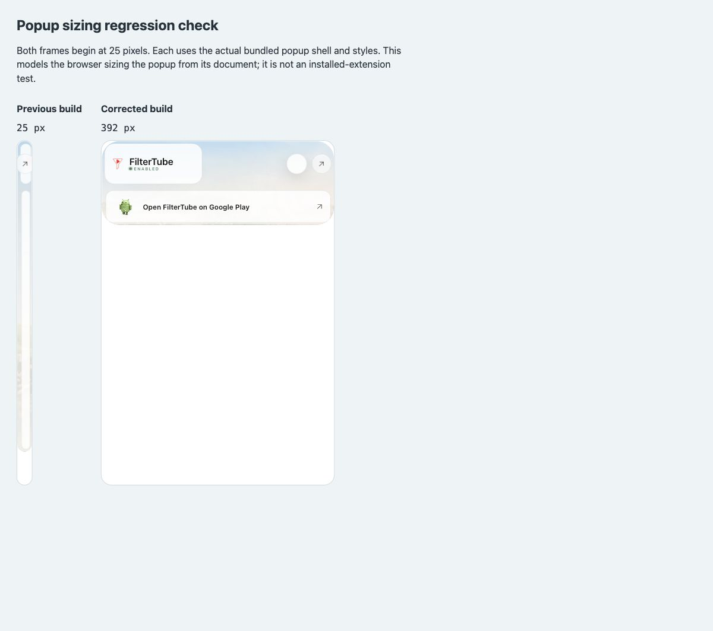
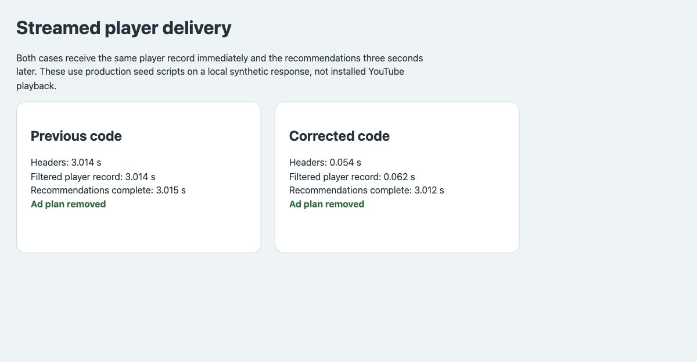

# Popup width and streamed playback — 2026-10-22

Status: source corrections, executable regression coverage and Chrome fixture verification. A reload of the newly built extension is required for installed popup and YouTube timing acceptance. No publish or push is authorized here.

## Narrow toolbar popup

The supplied screenshot shows the toolbar popup collapsed into a thin vertical strip. The earlier responsive change in `920ec56b` changed the root's maximum width from its preferred 392 pixels to `100vw`, and its minimum width to zero. The popup's viewport is itself derived from its intrinsic document size. At a tiny initial viewport this maximum clamps the intended width, leaving a sizing feedback loop. The rest of the popup inherits percentage widths and cannot establish a larger size.

`src/extension-shell/shared/runtime.js` now establishes an explicit root width and maximum width, independent of that bootstrap viewport. Its preferred 392 CSS pixels are capped using a positive, finite `screen.availWidth` for narrower real screens. Body and mount retain their flexible constraints; tab-view does not query or adopt popup sizing. Both generated UI bundles were rebuilt from the source.

Five executable tests cover the intrinsic size, 280–1440 pixel screen cases, invalid/unavailable dimensions, no viewport measurement, tab-view isolation and missing DOM nodes. Three failed against the old implementation. A local Chrome preview using actual old/new bundles and shared styles reproduced **25 px before and 392 px after**. It renders only the popup shell, without profile/storage/controller initialization; it is not installed-popup acceptance.

## Delayed Watch playback

After reloading the prior advert correction, the user reported that adverts were gone but Rabiosa started slowly. Read-only inspection of that active YouTube tab confirmed settings loaded, filtering enabled and sponsored filtering enabled. Advert Void remained `ad-not-active`. The retained log showed player/get_watch advert-plan removal, without `ad-detected`, advancement, quarantine or requested-content transition events for the reported wait. The generic fallback's seek safeguards therefore have not been established as the cause of this case.

A controlled replay in the same playlist recorded a media `waiting` event at **1,611 ms**, `loadedmetadata` at **26,770 ms**, and `playing` at **27,441 ms** relative to the probe. Those events reported no active advert. This is the observed startup delay before the new streaming patch, not a benchmark of corrected installed playback. The temporary probe only recorded events and was removed after collection.

The existing fetch hook awaited `response.clone().json()` and rebuilt the full response before resolving it. The repository's captured get_watch payload is a top-level array: its first record contains `playerResponse`, and its second contains `watchNextResponse`; both carry response-type/completion metadata. Buffering that whole response can hold an already available player record behind later recommendation data. The observed sanitization timestamp near metadata readiness supports investigating that boundary, but does not establish that every millisecond of the live delay came from it.

The new path applies only to the exact `/youtubei/v1/get_watch` pathname. It returns headers without waiting for the complete body and sanitizes complete array records incrementally, forwarding the record delimiter as soon as it arrives. UTF-8 decoding and JSON string/escape/nesting state continue across byte chunks. Protocol record envelopes remain in order; nested advert owners and player plans are sanitized through the existing production filter. Disabled/no-work requests return the original response before acquiring a reader. Cancellation and failures release the original reader; transformed bodies drop stale wire length/compression headers. No request is blocked, duplicated or replaced with a separate API call. No player seek guards were weakened.

Unknown non-array roots intentionally retain buffered processing. The streaming path changes fetch delivery, not XHR partial-response semantics. It preserves top-level protocol frame boundaries; it does not promise to remove whole synthetic ad-only protocol records as though they were UI card arrays.

The new streaming suite passes 22 cases, including a held-tail test that fails against the old code because headers wait for the unreleased tail. It also covers byte-by-byte boundaries, Unicode/escapes/nesting, malformed input, opt-out/Disabled, body cancellation and upstream errors. Three cases execute the actual general filtering engine for blocklist keywords, whitelist keywords and category policy, preserving player identity, formats and continuations. Unresolved categories retain their existing DOM hydration/pending authority; these tests do not establish final admission of unresolved content. Independent review reported 194 additional chunk-boundary checks without a failure.

A Chrome fixture served the same player record immediately and held its recommendations for three seconds. Using the actual old seed, headers/player arrived at **3.014 s**; with the corrected seed, headers arrived at **0.054 s** and the filtered player record at **0.062 s**. The recommendation tail completed at approximately **3.012 s**. Both bodies had the advert plan removed. These synthetic timings prove the buffering correction in Chrome, not a promised YouTube startup time.

## Validation results

- New popup and streaming regression suites: **27/27 passed**.
- `npm run test:smoke`: **387/387 passed**.
- `npm run test:release`: **257/257 passed**, after all packages finished building.
- `npm run test:performance`: **190/233 passed, 43 failed**. An isolated pre-change archive at `54d1396a96d8649998c6978c4b69ca027b5295d8` produced **163/206 passed, 43 failed** without the 27 new checks. All 43 failing test names match. Failures include old inventories, broken fixture harnesses and earlier lifecycle/claim-boundary disagreements, rather than exclusively stale hashes. Already-failing tests can mask later assertions.
- `npm run test:json`: **455/583 passed, 128 failed**. All 128 failure names match the previously established pre-advert baseline at `14f08c4b`; see `ADVERT_CONTENT_FILTERING_2026-10-22.md`. The broader JSON lane remains open, not healthy by inference from matching names.
- Runtime syntax checks and `git diff --check`: passed.
- Chrome, Firefox and Opera v3.4.1 packages built locally. Changed packaged runtime bundles/seed and generated README match source, staged output and ZIP bytes for all three browsers. Native app assets were not synchronized or modified.

Affected current lexical inventories, source fingerprints and generated README pins were refreshed without deleting semantic assertions. These results establish source/fixture/package behavior, not store submission, release approval or installed-device parity.

## Android comparison and acceptance

Android's `NativeOwnedMainPlaybackBackendPolicy` normally chooses the native Media3 service for Watch and valid Shorts routes, retaining a WebView bridge as fallback. The browser extension relies on YouTube's web player. Its success criteria can match Android's user experience, but copying native/fallback seek behavior does not establish safe web-player parity. Separate source review found stale-duration and failed-seek retry risks in the generic fallback; neither was observed in this replay and neither was changed in this patch.

Reload the new local build, reopen the toolbar popup and replay the same video. Verify usable popup width, settings delivery, early sanitized player availability, no visible or audible advert, normal startup, and retention of the requested video. Keep actual installed timing separate from the fixture measurements above. Browser tooling still cannot open extension-management URLs; no workaround was used to bypass that restriction.

The previews can be reproduced with `python3 docs/audit/artifacts/responsive-settings-popup-streaming-2026-10-22/preview.py`, then opening `http://127.0.0.1:8766/` and `/stream-check`. The server binds only to localhost, uses baseline commit `54d1396a`, and serves only the fixture and necessary public UI assets. Stop it after testing.
