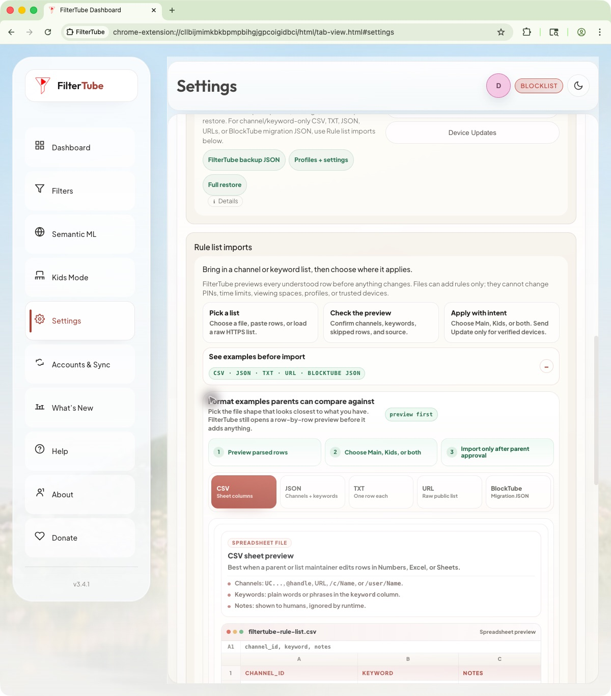

# Responsive Settings and popup correction — 2026-10-17

The supplied screenshots showed Settings squeezed into a narrow left column with unused space beside it. At a 1180 CSS-pixel viewport, the source layout reproduced a 417px Settings core and a 225px rule-list text area whose content needed 370px. The sidebar, two-column Settings grid, fixed 200px import actions and viewport-based preview breakpoints compounded each other.

## Changes

- Settings uses one full-width core column. Short language, backup and extension-update cards fit into available columns below it.
- Backup text and actions use an intrinsic wrapping grid. Rule-list examples and actions each receive the full card width. Format labels, disclosure badges and safety steps wrap instead of clipping.
- Format panels respond to their container width, including the sidebar and card gutters. On narrow screens, the CSV sheet keeps all four columns in its own horizontally scrollable region. The named table receives keyboard focus; arrow keys can scroll it. Nested phone gutters are smaller.
- The popup retains its preferred 392px width but can shrink with a narrower host. Dashboard mobile frame padding no longer overrides popup frame padding. Source and both generated shell bundles are updated together.
- Dashboard app links fit their actual column width instead of requiring two 19rem tracks inside a narrower column.
- Pairing form fields include padding and borders in their declared width. The 360px source fixture reproduced a 248px input inside a 214px field before this correction, and matching 214px widths after it.

These changes preserve existing control IDs, data, permissions, filtering and pairing logic. No pairing was started, profile policy changed, rule imported or backup downloaded during this layout check.

## Evidence

[Measurements](artifacts/responsive-settings-2026-10-17/layout-measurements.json) distinguish static layout checks from installed behavior.

- Source HTML/CSS fixture, extension scripts removed: Settings with BlockTube disclosure open at 320, 360, 640, 768, 930, 1085, 1180, 1360 and 1440 CSS pixels. No page or view horizontal overflow, and no measured clipping in import rows, disclosure summaries, format labels/panels or visible import-action buttons.
- The same fixture checked Dashboard, Filters, Kids and Account & sync at 320, 360, 768, 1180 and 1440px. No page or view horizontal overflow after the dashboard correction. These are initial/static states, not every populated list or device state.
- Rendered popup shell at 320, 360, 392 and 640px: root/body widths were 320, 360, 392 and 392px respectively, with no page overflow. The fixture runs the actual generated popup shell but excludes storage-dependent popup behavior.
- Keyboard check at 360px: Right Arrow selected JSON from CSV in the existing radio group. The focusable CSV table accepted Right Arrow and moved its own horizontal scroll position to 40px.
- Installed Chrome for Testing parent-acceptance profile: rebuilt extension Settings inspected on the desktop and at an emulated 360 × 800px viewport; full popup inspected at 360 × 800px, including active Master profile, Blocklist control, rule entry and Google Play link. Temporary emulation and inspection panels were reset afterward.
- 666 account/sync tests, 263 focused issue tests and 40 UI/localization checks passed. These groups overlap; counts must not be summed as unique tests. Chrome, Firefox and Opera builds succeeded.

Argon Medium reviewed the proposed layout and highlighted overflow containment and keeping review context connected to actions. A subagent independently traced the CSS cascade and caught inherited spreadsheet cell placement, which was corrected. FreeLLMAPI GPT-OSS 120B supplied a checklist proposal; invented labels and invalid contrast units were rejected. Model suggestions are not test evidence.

[Installed Settings at 360px](artifacts/responsive-settings-2026-10-17/settings-installed-360.png) · [Installed popup at 360px](artifacts/responsive-settings-2026-10-17/popup-installed-360.png)

## Remaining acceptance

The broad historical blocking/smoke lanes described in the linked-issue audit remain non-green; this CSS work does not resolve those failures. Physical Firefox Android, Android TV/D-pad, actual paired-device transport, populated/mixed sync batches and every translation/zoom state still need their own acceptance. Browser device emulation is not physical-device or network proof. See [the issue audit](ISSUE_REVIEW_69_75_76_77_79_80_81_2026-10-17.md) and [device acceptance checklist](../design/device-sync/INSTALLED-ACCEPTANCE-2026-10-17.md).

Changes remain local. Nothing was pushed, submitted to extension stores, or posted to GitHub issues.
