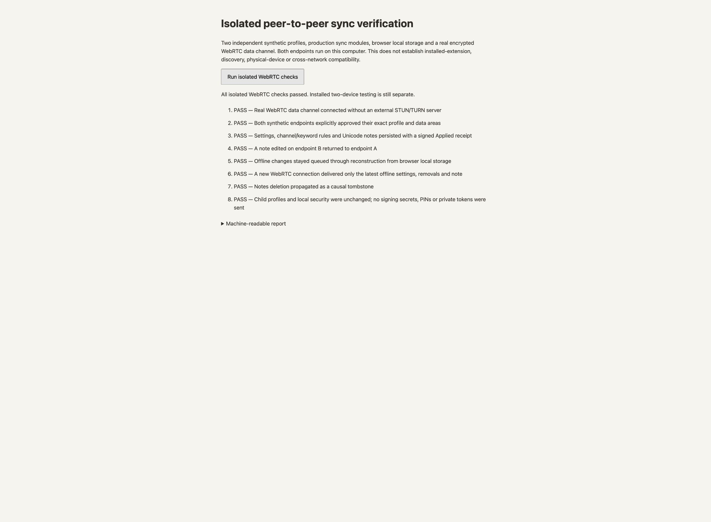

# Auto-sync recovery and receiver hardening

Date: 2026-10-24. Extension candidate only. Two installed Chrome profiles have **not** completed pairing or Auto-sync testing. Android does not yet implement this update. No native mirrors, app builds, releases, pushes or external issue comments were made.

## Findings fixed

1. **False Applied after a storage failure.** `FilterTubeIO.saveProfilesV4()` can resolve `{ok:false}` without throwing. Personal and managed receivers now require successful persistence and read back the target profile before acknowledging application. Tests also cover a reported successful save that silently drops its write. Protected decision-history persistence returns failure when the save cannot be verified.
2. **An obsolete conflict decision could overwrite a newer update.** A settings review now checks the exact received revision again after consent, after asynchronous work and before committing receipt metadata. Stale modal decisions fail instead of rolling the sequence backward.
3. **Two dashboards could interleave settings application and receipt metadata.** Personal receives now require a shared per-grant Web Lock spanning application, metadata and acknowledgment. The actual dashboard provides this lock separately from the existing configuration and profile-write locks. Consent stays outside the transaction. Missing receive locking fails closed.
4. **Verified mode replacements could not return from whitelist to blocklist.** Main and Kids now honor an explicit valid blocklist mode for replacement updates. Merge or unspecified-mode behavior retains its previous conservative handling. The two signed receiver regressions failed before this fix and pass afterward.

The persistence regressions also failed against the pre-fix adapter. Tests assert stored data and receiver receipts rather than trusting a successful send call.

## Evidence levels

| Check | What it exercises | Boundary |
| --- | --- | --- |
| `tests/runtime/auto-sync-two-endpoint.test.mjs` — 12 checks | Independent storage, signing keys and production controllers; real personal signatures, reciprocal grants, settings/rules/Notes, offline reconstruction, latest-snapshot coalescing, lost/delayed receipts, concurrent changes and revocation | Confirmed Nanah sessions and user consent are fixture inputs; timers are explicitly driven |
| `tests/runtime/managed-auto-sync-two-endpoint.test.mjs` — 29 checks | Real first-pair receiver handlers, independent FilterTubeIO storage, actual sender surface selection, managed envelope/signature validation and stored receiver policy | Transport is in memory; no installed browser or physical network |
| `tests/runtime/personal-auto-sync-adversarial.test.mjs` — 8 checks | Stale review, two-runtime transaction races, session/consent changes and required receive locking | Deterministic scheduling with controlled waits |
| `tests/runtime/auto-sync-dashboard-integration.test.mjs` — 8 checks | Source-derived actual dashboard callbacks, failed/dropped writes, profile/security CAS, callback Chrome and Promise Firefox adapters, shared-lock wiring | VM adapters, not installed extension APIs |
| `browser.html` / `browser.js` — 8 visible checks | Actual Chrome WebCrypto, localStorage and encrypted RTCDataChannel, including channel closure, reconstruction and a second connection | Two synthetic endpoints on one page; local SDP bridge, no production Nanah signaling, discovery, safety-phrase UI or background scheduling |

The [browser report](browser-report.json) records two RTC connections, 12 messages and 11,207 encoded bytes. The run synced settings, channel/keyword rules and Unicode Notes; returned a reverse Notes edit; retained offline changes across storage reconstruction; delivered the latest snapshot after reconnect; propagated a deletion tombstone; and checked that private authority fields and unrelated child profiles stayed local. Synthetic consent callbacks were invoked at both endpoints. They do not establish human consent on installed devices.



## Supported data and remaining gaps

Parent-to-child managed grants send only their already approved scopes:

- Main mode and channel, keyword and video rule lists.
- Kids mode/lists plus Kids-owned strict mode, subscriptions, content/category/language filter groups.
- Viewing access and normalized saved time-limit policy through their separate approved scopes.

General child `settings` toggles such as `hideShorts` and `disableAutoplay`, top-level/Main content filter groups and child Notes are **not represented by current managed grants**. The sender-selector test records this boundary. Existing permissions were not silently broadened to add them. A future capability needs explicit scope design and receiver consent, plus downstream app implementation.

Personal own-account grants independently support their explicit settings/filter selectors and saved Notes. They require active unlocked account profiles on both ends and both approvals. Children cannot use this protocol to obtain a personal publishing or administrative route. It is not a workaround for missing managed scopes.

Offline queue recovery still needs an established verified Nanah connection. Both Accounts & Sync pages must remain open. Automatic saved-peer rendezvous, closed-browser wakeup, restrictive NAT/TURN and non-overlapping availability are not implemented or established by these checks. A browser being online does not itself reconnect the session.

## Reproduce the isolated browser check

From the repository root, serve only for local testing:

```sh
python3 -m http.server 58321 --bind 127.0.0.1 --directory "$PWD"
```

Open `http://127.0.0.1:58321/docs/audit/artifacts/auto-sync-two-endpoint-2026-10-24/browser.html` in Chrome and select **Run isolated WebRTC checks**. The fixture uses only randomly namespaced test storage and removes those exact keys at completion. It does not inspect extension data. Stop the local server afterward. The fixture imports the current source files, so a rerun after source edits is new evidence, not a reproduction of the older fingerprints automatically.

## Final local checks

- Focused sync and Notes: **397/397**.
- Smoke: **1,379/1,379**.
- Release lane: **668/668**; this is an automated lane, not release approval.
- Settings: **1,057/1,152**, with **95 failures whose exact titles match the pre-change baseline**. These remain unresolved; the broader settings lane is not green.
- Chrome, Firefox and Opera packages built. Seventeen source runtime assets match each unpacked build and each ZIP byte for byte. Current fingerprints are in [verification.json](verification.json).
- Completed GPT-OSS 120B FreeLLMAPI checklist was advisory. A truncated Qwen response was discarded. Source, regressions and observed results determine these claims.

## Installed acceptance still required

The user identified another Chrome profile on this Mac, confirmed reloading, and confirmed that pairing has **not** happened yet. Browser tooling rejects extension-page protocols, so installed extension controls were not accessed through another surface or debugger bypass. No real-device Auto-sync grant was enabled by this work.

Use disposable account profiles in two separate Chrome profiles, both loading the current `dist/chrome` build:

1. Pair by code/QR; compare and confirm the same safety phrase. Check the displayed source and recipient before saving trust. Nearby presence alone does not authorize anything.
2. For personal settings/Notes, select those areas and use **Link this profile**. Approve the exact profile mapping on both devices. Confirm Auto-sync starts off before opting in.
3. Add a test channel/keyword, change a supported toggle and save a harmless Note. Check actual stored receiver values and Applied separately from Sent. Edit the Note on the other side, then delete it.
4. Disconnect/end the session. Make two different offline changes. Reopen/restart the receiving dashboard, re-pair/reconnect and verify only the latest pending state arrives. Merely reopening the network is not sufficient.
5. Try a concurrent conflicting settings edit and both review choices. Switch/lock a profile, revoke/unlink the test grant and verify pending work cannot cross into another profile or apply after revocation. Multiple open dashboards must not revive stale decisions.
6. Independently test parent-to-child approved Main/Kids rules, both mode directions, viewing access and time limits. Verify PINs, ownership, siblings and child administration restrictions. Do not use personal sync for a child.
7. Repeat manual Send and recipient review to check the existing path. Then perform separate physical LAN, separate-network, Firefox, Opera and downstream native acceptance.

Record results only after observing both endpoints; reload alone is not pairing or sync proof. Keep store submission and publishing on hold.
